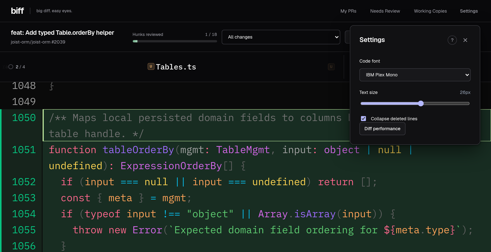
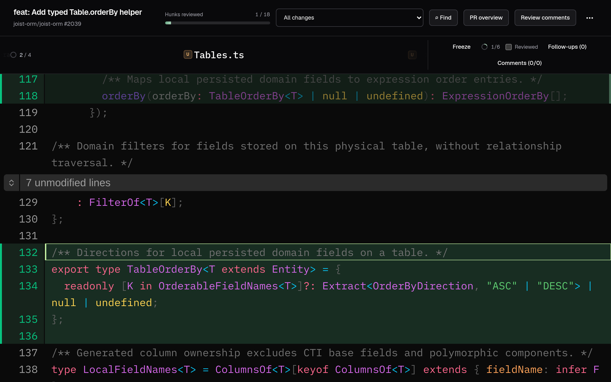
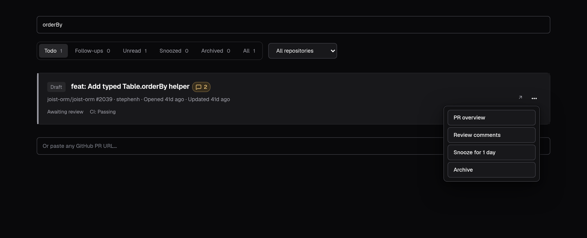
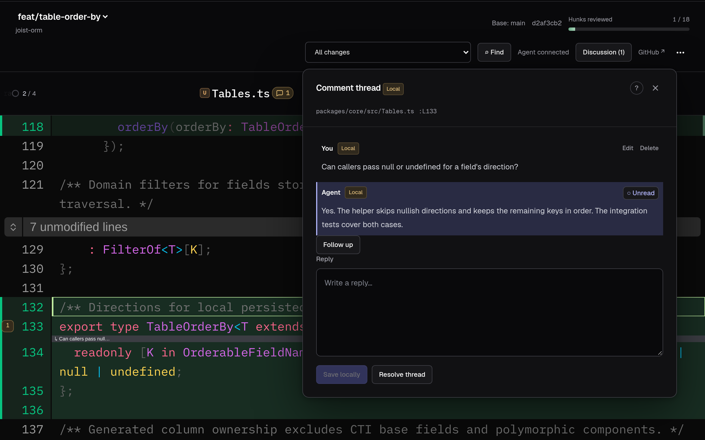
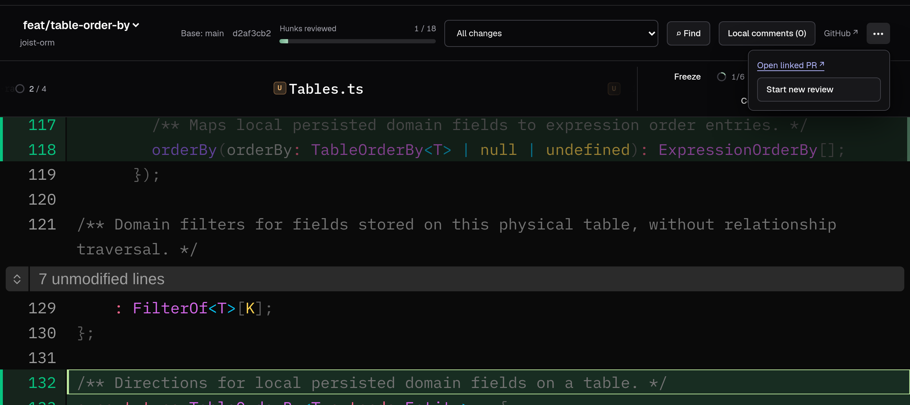
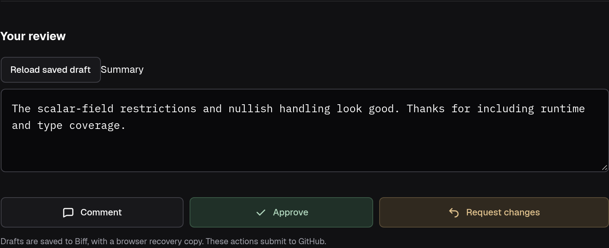
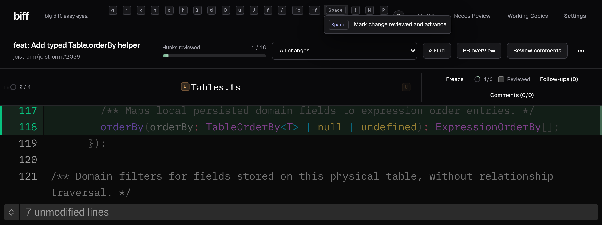

# Biff — big diff

A browser-based diff viewer focused on:

1. "big text" -- I'm old & need bigger fonts,
2. hunk-level incremental progress tracking -- game changer for coming back into PRs
3. PR dashboard that doesn't suck -- todo, archive, snooze, new changes, unread replies

[Here's a demo video.](https://www.youtube.com/watch?v=HV-A_erOV1o)

[](https://www.youtube.com/watch?v=HV-A_erOV1o)

## Features

Screenshots use [joist-orm/joist-orm#2039](https://github.com/joist-orm/joist-orm/pull/2039). Review marks, inbox state, and comments are demo examples, not published reviews.

<table>
  <tr>
    <td width="35%" valign="top">
      <h3>Big, readable diffs</h3>
      <p>Code starts at 22px, with adjustable fonts and text size. Deleted code and TypeScript import changes collapse out of the way when you don't need them.</p>
    </td>
    <td width="65%" valign="top">
      <a href="docs/screenshots/readable-diffs.png"></a>
    </td>
  </tr>
  <tr>
    <td valign="top">
      <h3>Hunk-level review progress</h3>
      <p>Mark individual changes reviewed, not just whole files. Come back after new commits and unchanged hunks stay reviewed, so you can focus on what's new.</p>
    </td>
    <td valign="top">
      <a href="docs/screenshots/review-progress.png"></a>
    </td>
  </tr>
  <tr>
    <td valign="top">
      <h3>A PR inbox</h3>
      <p>Separate queues for your PRs, review requests, and Dependabot, with unread activity, pins, snooze, and ignore. See which PRs have new commits or replies without opening each one.</p>
    </td>
    <td valign="top">
      <a href="docs/screenshots/pr-inbox.png"></a>
    </td>
  </tr>
  <tr>
    <td valign="top">
      <h3>Inline feedback for coding agents</h3>
      <p>Use <code>/biff</code> to review an agent's work in the browser and leave comments on specific lines. The agent gets your feedback and replies in the same threads.</p>
    </td>
    <td valign="top">
      <a href="docs/screenshots/agent-feedback.png"></a>
    </td>
  </tr>
  <tr>
    <td valign="top">
      <h3>Local reviews that carry over to GitHub</h3>
      <p>Review a JJ bookmark before opening a PR, with saved progress and local comments. When Biff identifies the matching PR, both views share that review; comments stay local until you publish them.</p>
    </td>
    <td valign="top">
      <a href="docs/screenshots/local-to-github.png"></a>
    </td>
  </tr>
  <tr>
    <td valign="top">
      <h3>GitHub reviews without switching tools</h3>
      <p>Read PR discussions, reply to threads, and submit comments, approvals, or change requests from Biff. Review the full PR or select an individual commit without changing your checkout.</p>
    </td>
    <td valign="top">
      <a href="docs/screenshots/github-review.png"></a>
    </td>
  </tr>
  <tr>
    <td valign="top">
      <h3>Keyboard-driven navigation</h3>
      <p>Move between files, lines, and unreviewed changes without reaching for the mouse. Space marks a change reviewed and moves on; shortcuts reveal surrounding code and collapsed deletions when needed.</p>
    </td>
    <td valign="top">
      <a href="docs/screenshots/keyboard-navigation.png"></a>
    </td>
  </tr>
</table>

## Install and launch

Requires Bun, Jujutsu (`jj`), and GitHub CLI (`gh`, authenticated with `gh auth login`).

```sh
bun install
bun run build
bun link
# Ensure ~/.bun/bin is on PATH.
cd ~/homebound/graphql-service
biff                 # register this working copy and open @
biff @-              # previous commit
biff --dashboard     # all registered working copies
biff --prs           # GitHub review queues
biff @ --no-open      # print a review URL without opening the browser
```

The CLI starts or reuses a local Bun daemon at **http://127.0.0.1:4567**. It serves the built React SPA and runs `jj`/`gh` directly. Credentials remain with `gh`.

- `BIFF_PORT` overrides port 4567.
- `BIFF_PUBLIC_ORIGIN=https://biff.draconian.app` opts the daemon into one additional HTTPS origin behind a reverse proxy. It does not change the loopback listener or CLI URLs. See [Caddy and systemd deployment](deploy/README.md) for the Tailscale-only setup, security requirements, and daemon handover commands.
- `BIFF_DATA_DIR` overrides the data directory (default: `$XDG_DATA_HOME/biff`, or `~/.local/share/biff`). All backend state uses one SQLite database, `inbox.sqlite`: working copies, review lifetimes, progress, discussions, comment reads, publication receipts, agent sessions and delivery cursors, repository users, and the PR inbox. The CLI-started daemon writes logs to `daemon.log`.
- SQLite uses WAL mode and transactions. Nested review/session payloads remain JSON within individual database rows; registrations and review aliases have their own tables. Old JSON files are neither read nor imported. `BIFF_REVIEW_DIR` is no longer used. Re-register working copies with `biff` or the dashboard after switching from the JSON-backed version.
- `bun start` runs the daemon in the foreground. After updating Biff, rebuild and restart the daemon to pick up server changes.

## More to add

- Working copies
- Local commits & agent sessions
- Persist review identity
- Comments are auto-migrated
- `/biff`
