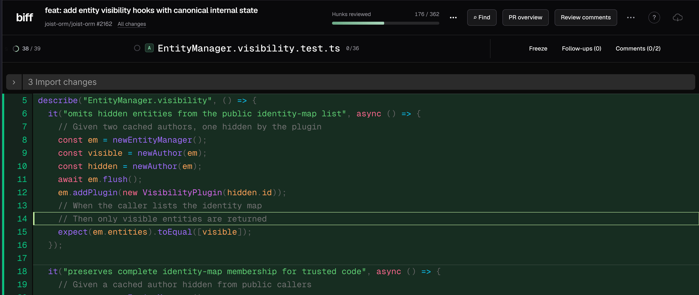
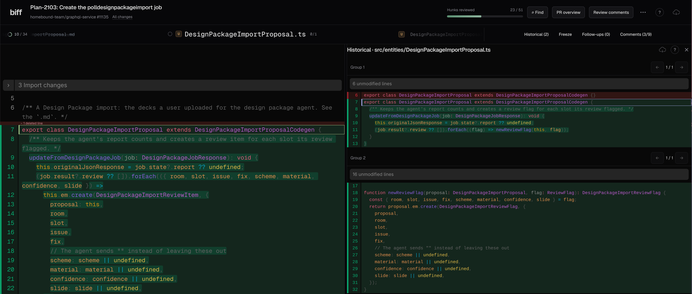
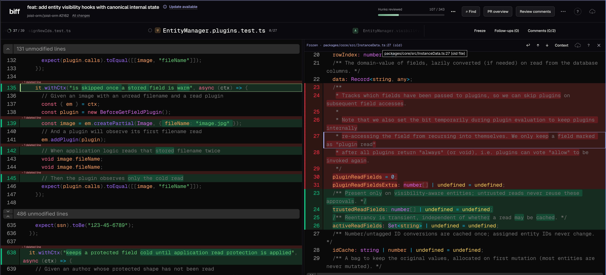
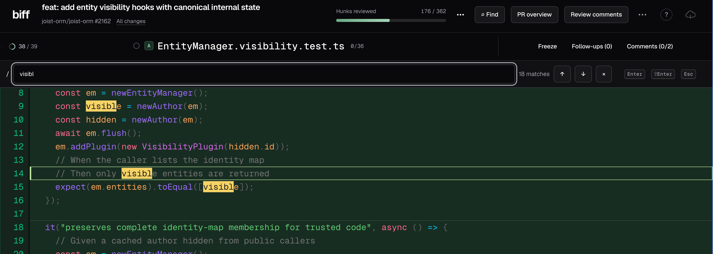
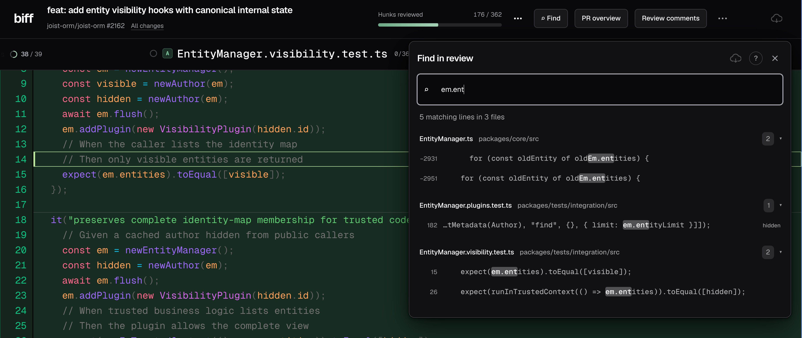

# Biff — big diff

A browser-based diff viewer focused on:

1. "big text" -- I'm old & need bigger fonts,
2. hunk-level incremental progress tracking -- game changer for coming back into PRs
3. PR dashboard that doesn't suck -- todo, archive, snooze, new changes, unread replies

[Here's a demo video.](https://www.youtube.com/watch?v=HV-A_erOV1o)

[](https://www.youtube.com/watch?v=HV-A_erOV1o)

## Features

Screenshots include [joist-orm/joist-orm#2039](https://github.com/joist-orm/joist-orm/pull/2039).

### 1. Novel Unified Diff View

I've always preferred split diffs, because you see "the new code" as one coherent chunk.

But side-by-side leaves new code only a fraction of space, and I need bigger fonts, so biff uses unified style _but_ auto-coallpsed deleted lines by default:

[](docs/screenshots/readable-diffs.png)

This gives the best of both worlds--see only new code, deleted code at a glance, and use your fullscreen real estate.

### 2. Per-Hunk Progress Tracking

GitHub only tracks "have you viewed _this entire file_", but in PRs with either agents or humans I'm popping in & out all the time and only care about _unreviewed hunks_.

Biff tracks every hunk as reviewed/not-reviewed, mark hunks reviewed with `space`, `n` moves to "next unreviewed hunk":

[](docs/screenshots/review-progress.png)

We still read/write GitHub's file-reviewed progress flag, but it's derived by "have you reviewed all hunks".

### 3. Logical Hunk Identities

Since we track per-hunk progress, it would be problematic if code above/below a hunk changing made you re-review the hunk (i.e. because it was nudged up/down a few lines in the file)

To avoid this, hunk identity is only `file path + hash(diff contents)`, without the line numbers, so hunks can move around a bit and not loose your flagged.

### 4. Breaking up Large Hunks

A new file or a large addition can show up as one giant hunk, but really I want to read it incrementally, and only have to re-review smaller chunks of it that change while iterating.

Biff automatically breaks add-only and delete-only hunks into smaller chunks at blank lines, which across programming languages are a surprisingly universal "grouping of related code" separate, and each chunk gets its own progress tracking:

[](docs/screenshots/large-hunks.png)

### 5. Actually Useful PR Inbox

I've used multiple PR inboxes over the years, GitHub, Graphite, Linear, but didn't find any of them "actually useful", primarily because I could never achieve "inbox zero" against the long-tail of PRs I was never going to get to.

Biff has a PR inbox that you can actively triage, hit `s` to snooze a PR for a day, `a` to archive it & remove yourself as a reviewer (it will be resurrected if the reviewer adds you back in GitHub).

There are also flags for unread comments/replies, so you can stop scanning the giant list of GitHub notifications in Slack wondering wtf you missed.

[](docs/screenshots/pr-inbox.png)

### 6. Local Reviews with Agents 

Besides GitHub PRs, Biff can show diffs of Jujutsu or git working copies on your local machine, as a `jj diff` / `git diff` replacement.

The incremental progress tracking works especially well for "I've reviewed 90% of the agent's output, prompt to make a small change ... now what _really_ do I need to re-review"?

There is also a `/biff` skill/command, which will have the agent poll your local review for comments, and instantly respond.

As a bonus, if you use Jujutsu, after you've reviewed your change locally, and publish it to GitHub, Biff can realize "this is the same change", and will merge the local-review & GitHub-review so all of your progress tracking is kept.

[](docs/screenshots/agent-feedback.png)

### 7. Vim-Style Shortcuts Everywhere

Every page has a `?` icon which shows the keyboard shortcuts, which are vim/Linear inspired.

`j/k` for up/down in tables, `h/l` for left/right across files in the PR or tabs in a table, `space` to mark hunks as review or comments as read, `n/p` for next/preview unreviewed hunk, `r` to resolve comments, and many more.

[](docs/screenshots/keyboard-navigation.png)

### 8. Historical Hunks

Very hunk you see/focus is tracked, and then `H` will show you all historical hunks for this file, grouped by overlapping line numbers:

[](docs/screenshots/historical-hunks.png)

### 9. Frozen Pane

When viewing moved code, use `f` to open a split pane that freezes the current code, and then navigate to "where it moved to" to easily do a side-by-side _across different files & different locations_.

[](docs/screenshots/frozen-pane.png)

### 10. Vim-Style Incremental Search

Hit `/` to search the current file, with matches highlighted as you type. Use `Enter` / `Shift+Enter` to move to the next/previous match, and `Escape` to clear the search and get back to reviewing.

[](docs/screenshots/incremental-search.png)

### 11. PR-Wide Full-File Search

Hit `Ctrl+F` / `Cmd+F` to search across all files in the PR, including unchanged code outside the diff. Results are grouped by file, so you can find a reference without opening every file or expanding all the hidden lines.

Use the arrow keys to preview matching lines, then `Enter` to jump into the code.

[](docs/screenshots/pr-wide-search.png)

## Personal preferences

Edit [`src/config.ts`](src/config.ts) for auto-read comment authors, auto-reviewed file paths/names/suffixes, default reading settings, and diff appearance. Auto-reviewed paths match from the repository root; names and suffixes match in any directory. Saved browser settings take precedence over reading defaults.

Rebuild and restart Biff after changing this file, then refresh the browser tab.

## Install

> Disclaimer there are probably "works on my machine"-isms, i.e. my `draconian.app` domain name floating around.

Requires Bun and Git. Jujutsu (`jj`) is needed only for JJ workspaces; GitHub features require GitHub CLI (`gh`, authenticated with `gh auth login`).

```sh
bun install
bun run build
bun link
# Ensure ~/.bun/bin is on PATH.
cd ~/homebound/graphql-service
biff                 # register this working copy and open @
biff @-              # previous commit
biff --dashboard     # all registered working copies
biff --prs           # GitHub review queues
biff @ --no-open      # print a review URL without opening the browser
```

The CLI starts or reuses a local Bun daemon at **http://127.0.0.1:4567**. It serves the built React SPA and runs `jj`/`git`/`gh` directly. Credentials remain with `gh`.

Git-only repositories and linked Git worktrees work without JJ installed. Colocated repositories continue to use JJ. In Git, `biff @` reviews staged, unstaged, and non-ignored untracked files against HEAD; `biff @-` reviews HEAD itself. You can also pass a Git ref or commit ID. The default branch review uses the merge base with `origin/HEAD`, `main`, or `master`; `biff review start --bookmark feature/name` selects a Git branch explicitly. Git working-tree reviews are live: file modification times and sizes, HEAD, and the index are checked before loading context or saving comments. Stale requests ask you to refresh. Biff does not create Git commits, objects, refs, or private indexes. A Git branch's review lasts until you start a new review or its linked PR closes.

- `BIFF_PORT` overrides port 4567.
- `BIFF_PUBLIC_ORIGIN=https://biff.draconian.app` opts the daemon into one additional HTTPS origin behind a reverse proxy. It does not change the loopback listener or CLI URLs. See [Caddy and systemd deployment](deploy/README.md) for the Tailscale-only setup, security requirements, and daemon handover commands.
- `BIFF_DATA_DIR` overrides the data directory (default: `$XDG_DATA_HOME/biff`, or `~/.local/share/biff`). All backend state uses one SQLite database, `inbox.sqlite`: working copies, review lifetimes, progress, discussions, comment reads, publication receipts, agent sessions and delivery cursors, repository users, and the PR inbox. The CLI-started daemon writes logs to `daemon.log`.
- SQLite uses WAL mode and transactions. Nested review/session payloads remain JSON within individual database rows; registrations and review aliases have their own tables. Old JSON files are neither read nor imported. `BIFF_REVIEW_DIR` is no longer used. Re-register working copies with `biff` or the dashboard after switching from the JSON-backed version.
- `bun start` runs the daemon in the foreground. After updating Biff, rebuild and restart the daemon to pick up server changes.
